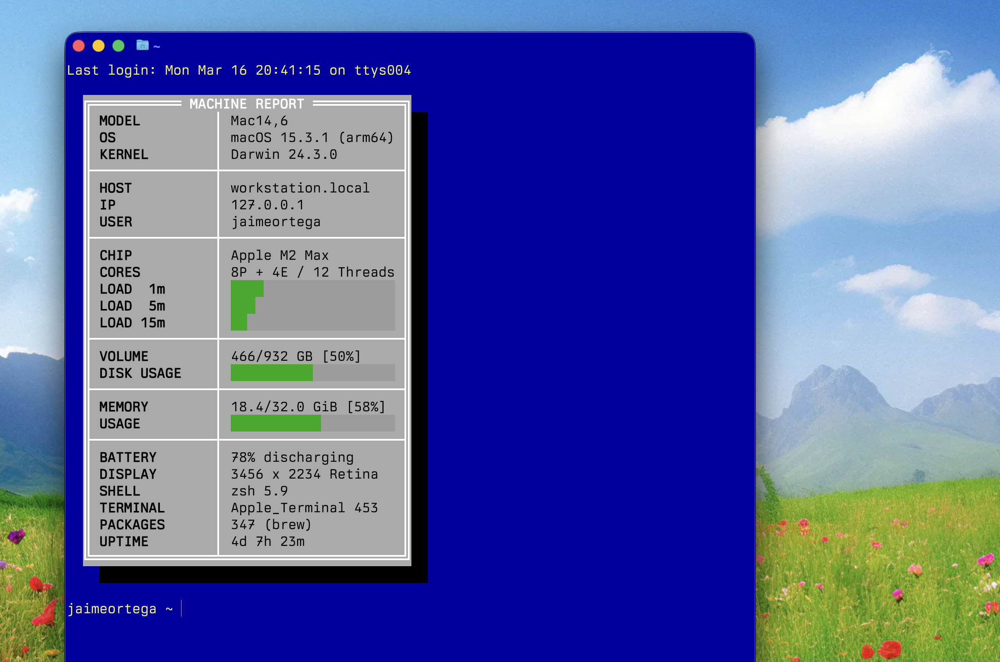

# Machine Report — macOS Edition

A personal fork of [U.S. Graphics Company's TR-100 Machine Report](https://github.com/usgraphics/usgc-machine-report), rewritten for macOS with a Borland Turbo Vision visual style.



The upstream project is a minimal system-info display for Debian/ZFS servers. This version adapts the idea for macOS (Apple Silicon and Intel), adds a retro TUI aesthetic with CGA colors and box-drawing characters, and includes bar graphs for load, disk, and memory.

## What it shows

| Section | Fields |
|---------|--------|
| System | Model, OS version, kernel |
| Network | Hostname, IP, current user |
| CPU | Chip name, core breakdown (P+E/threads), 1/5/15m load bars |
| Storage | APFS volume usage with bar graph |
| Memory | Used/total with bar graph |
| Misc | Battery, display resolution, shell, terminal, Homebrew packages, uptime |

## Installation

The report is a small native binary (`machine_report.swift`) — it draws in ~10 ms, versus ~870 ms for the original shell script, so it doesn't hold up new terminals.

```bash
# 1. Build and install to ~/.local/bin (needs Xcode Command Line Tools for swiftc)
make install

# 2. Add to your shell rc file (~/.zshrc or ~/.bashrc)
echo '[[ $- == *i* ]] && ~/.local/bin/machine-report' >> ~/.zshrc
```

Open a new terminal window to see the report.

Display resolution and shell version are slow to look up (a WindowServer round-trip and a fork), so they're cached in `~/.cache/machine-report/static` and refreshed in the background at most once a minute. Everything else is read live on every run.

`machine_report.sh` is the original shell version, kept for machines without a Swift toolchain; it renders the same box. To use it instead, `cp machine_report.sh ~/.machine_report.sh` and put `source ~/.machine_report.sh` in your rc file.

## Differences from upstream

- **Target platform**: macOS instead of Debian/ZFS — reads `sysctl`, Mach VM stats, `statfs`, IOKit power sources, and CoreGraphics directly
- **Visual style**: Borland Turbo Vision TUI with CGA colors, double-line box drawing, bar graphs, and a drop shadow
- **Demo mode**: `machine-report --demo` displays fake data — useful for screenshots or demos without exposing real system info
- **Extra fields**: Battery status, display resolution, Homebrew package count

## Customization

Following the upstream philosophy — **edit the source directly** (`machine_report.swift`, then `make install`). There is no config file. The source is organized in clearly marked sections:

- **Configuration** — title, demo mode flag
- **Colors** — all CGA palette values as 24-bit ANSI escapes
- **Layout** — column width limits, indent
- **Utilities** — box drawing, bar graphs, text wrapping
- **System queries** — helpers that read sysctl, Mach VM stats, `statfs`, IOKit, and Homebrew's install directories
- **Cached values** — display resolution and shell version, refreshed in the background
- **OS** through **Uptime** — one block per data category, all macOS-native
- **Demo mode overrides** — fake values for each field
- **Machine Report** — the print order; rearrange, add, or remove rows here

**Utilities** and **Machine Report** are platform-independent. **System queries**, **Cached values**, and the data blocks are macOS-specific and use Apple frameworks (IOKit, CoreGraphics), so porting to another OS means rewriting those sections.

Out of respect for the [original script](https://github.com/usgraphics/usgc-machine-report/blob/master/machine_report.sh), both sources try to keep its spirit: the same section order, the same short, plain comments, and its credits.

## Requirements

- macOS (tested on Apple Silicon, should work on Intel Macs)
- A terminal with truecolor (24-bit) support (Terminal.app, iTerm2, Kitty, Alacritty, etc.)
- Xcode Command Line Tools to build (`xcode-select --install`); the shell fallback needs only Bash 3.2+ or Zsh

## License

BSD-3-Clause — inherited from [upstream](https://github.com/usgraphics/usgc-machine-report).
